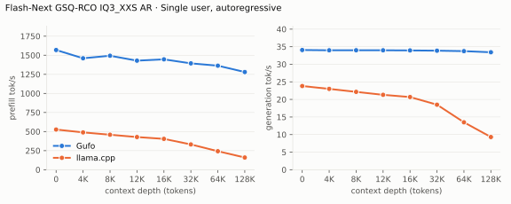
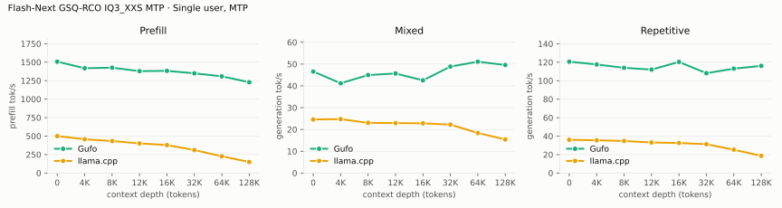
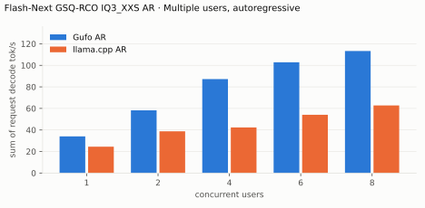
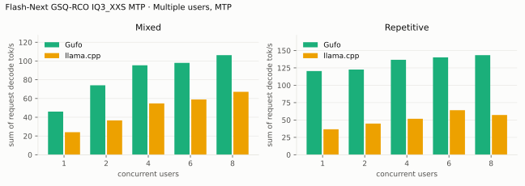
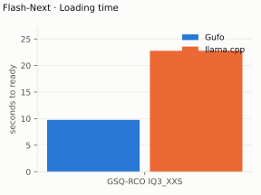
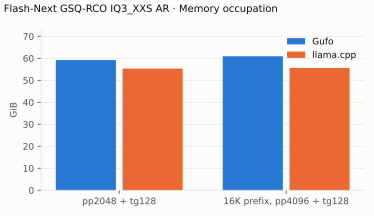

# Qwen3.8 Flash-Next GSQ-RCO benchmarks

AMD Strix Halo `gfx1151` in a 96 GB GMKtec Evo-X2 (about 92 GiB usable).
ISTA-DASLab GSQ-RCO `IQ3_XXS` target with shared-Q8_0 MTP; adaptive
drafting. HTTP, greedy, thinking off. Gufo `a7d2edd2` and llama.cpp `b11069`
AR / `6fcaa16f` MTP, both measured November 13, 2026. Positive gain favors
Gufo.

Both engines ran without swapping. llama.cpp keeps the 26.8 GiB per-layer
embedding in host memory beside its GPU weights.

[Quality and measurement details](QUALITY.md#benchmark-method) · [Model identities](artifacts/model-identities.json)

## Single user, autoregressive

Approximately pp2048 / tg128; depth is the cached prefix in tokens.
Context capacities differ between engines; see the measurement details.

<!-- bench:single-ar-iq3 -->
| Flash-Next GSQ-RCO IQ3_XXS AR Depth (tokens) | Gufo pp (tok/s) | llama.cpp pp (tok/s) | Gain | Gufo tg (tok/s) | llama.cpp tg (tok/s) | Gain |
| ---: | ---: | ---: | ---: | ---: | ---: | ---: |
| 0 | 1568.70 | 526.54 | +197.9% | 34.06 | 23.81 | +43.0% |
| 4,096 | 1460.38 | 489.11 | +198.6% | 33.98 | 23.00 | +47.7% |
| 8,192 | 1493.62 | 458.60 | +225.7% | 33.99 | 22.15 | +53.5% |
| 12,288 | 1429.25 | 428.10 | +233.9% | 33.98 | 21.31 | +59.5% |
| 16,384 | 1446.34 | 404.24 | +257.8% | 33.94 | 20.68 | +64.1% |
| 32,768 | 1393.73 | 331.30 | +320.7% | 33.87 | 18.50 | +83.1% |
| 65,536 | 1363.37 | 242.47 | +462.3% | 33.74 | 13.49 | +150.1% |
| 131,072 | 1279.98 | 159.85 | +700.7% | 33.42 | 9.30 | +259.4% |
<!-- /bench -->

## Single user, MTP

pp is the highest measured rate per engine and depth across mixed/repetitive
text, including Gufo predictor catch-up.

<!-- bench:single-mtp-iq3 -->
| Flash-Next GSQ-RCO IQ3_XXS MTP Depth (tokens) | Gufo pp (tok/s) | llama.cpp pp (tok/s) | Gain pp | Gufo tg mixed (tok/s) | llama.cpp tg mixed (tok/s) | Gain mixed | Gufo tg repetitive (tok/s) | llama.cpp tg repetitive (tok/s) | Gain repetitive |
| ---: | ---: | ---: | ---: | ---: | ---: | ---: | ---: | ---: | ---: |
| 0 | 1506.69 | 499.41 | +201.7% | 46.58 | 24.58 | +89.5% | 120.65 | 36.03 | +234.9% |
| 4,096 | 1418.10 | 457.43 | +210.0% | 41.21 | 24.75 | +66.5% | 117.64 | 35.50 | +231.4% |
| 8,192 | 1425.34 | 433.07 | +229.1% | 44.96 | 23.01 | +95.4% | 114.00 | 34.73 | +228.2% |
| 12,288 | 1378.51 | 401.12 | +243.7% | 45.68 | 22.92 | +99.3% | 112.08 | 33.11 | +238.5% |
| 16,384 | 1382.78 | 378.60 | +265.2% | 42.54 | 22.82 | +86.4% | 120.37 | 32.58 | +269.5% |
| 32,768 | 1349.19 | 310.45 | +334.6% | 48.84 | 22.22 | +119.8% | 108.22 | 31.23 | +246.5% |
| 65,536 | 1308.13 | 226.94 | +476.4% | 51.10 | 18.36 | +178.3% | 113.08 | 25.26 | +347.7% |
| 131,072 | 1228.70 | 149.42 | +722.3% | 49.58 | 15.42 | +221.5% | 116.10 | 18.67 | +521.9% |
<!-- /bench -->

## Multiple users, autoregressive

Same pp2048 prose prompt as single-user d0, tg128, context 4096 per user.
All sessions prefilled before timed decoding; throughput sums individual rates.

<!-- bench:multi-ar-iq3 -->
| Flash-Next GSQ-RCO IQ3_XXS AR Users | Gufo AR (tok/s) | llama.cpp AR (tok/s) | Gain |
| ---: | ---: | ---: | ---: |
| 1 | 34.06 | 24.47 | +39.2% |
| 2 | 58.25 | 38.75 | +50.3% |
| 4 | 87.21 | 42.31 | +106.1% |
| 6 | 102.85 | 54.08 | +90.2% |
| 8 | 113.32 | 62.76 | +80.6% |
<!-- /bench -->

## Multiple users, MTP

Same pp2048 mixed/repetitive prompts as single-user d0, tg128, context 4096
per user. All sessions prefilled before timed decoding; rates sum individual
request decode rates.

<!-- bench:multi-mtp-iq3 -->
| Flash-Next GSQ-RCO IQ3_XXS MTP Users | Gufo mixed (tok/s) | llama.cpp mixed (tok/s) | Gain | Gufo repetitive (tok/s) | llama.cpp repetitive (tok/s) | Gain |
| ---: | ---: | ---: | ---: | ---: | ---: | ---: |
| 1 | 46.04 | 24.05 | +91.4% | 120.46 | 36.63 | +228.9% |
| 2 | 74.11 | 36.65 | +102.2% | 122.59 | 44.89 | +173.1% |
| 4 | 95.42 | 54.79 | +74.2% | 136.70 | 51.74 | +164.2% |
| 6 | 98.04 | 58.94 | +66.3% | 140.13 | 64.09 | +118.6% |
| 8 | 106.24 | 67.16 | +58.2% | 143.34 | 57.18 | +150.7% |
<!-- /bench -->

## Loading time

C1, context capacity 262144. Cold target/sidecar files to HTTP readiness;
Gufo loads MTP, llama.cpp AR only.

<!-- bench:loading -->
| Flash-Next Target | Gufo ready (s) | llama.cpp ready (s) | Gain |
| --- | ---: | ---: | ---: |
| GSQ-RCO IQ3_XXS | 9.77 | 22.78 | +133.2% |
<!-- /bench -->

## Memory occupation

C1, context capacity 133121, AR. Peak memory reported by HIP. llama.cpp's
figure excludes the 26.8 GiB per-layer embedding it holds in host memory;
Gufo reads that tensor through the reclaimable file cache.

<!-- bench:memory-iq3 -->
| Flash-Next GSQ-RCO IQ3_XXS AR Workload | Gufo GiB | llama.cpp GiB | Gain |
| --- | ---: | ---: | ---: |
| pp2048 + tg128 | 59.21 | 55.32 | -6.6% |
| 16K prefix, pp4096 + tg128 | 60.95 | 55.65 | -8.7% |
<!-- /bench -->

