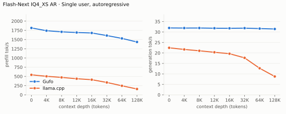
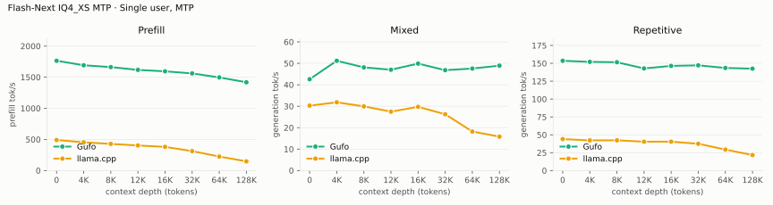
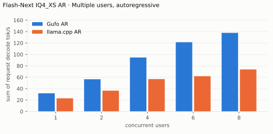
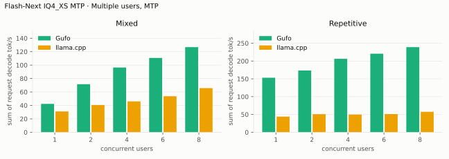
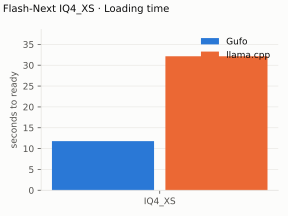
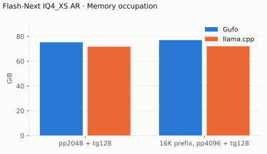

# Qwen3.8 Flash-Next UD-IQ4_XS benchmarks

GMKtec Evo-X2, AMD Strix Halo `gfx1151` with 96 GB unified memory (about 92
GiB usable), Ubuntu 24.04, `powersave` governor. Unsloth `UD-IQ4_XS` target
at revision `38bb39ee9782` with the shared-Q8_0 MTP predictor; adaptive
drafting. HTTP, greedy, thinking off, one sample per point.
Strycast `274e0ba0` (November 9, 2026); llama.cpp `68d9053a` AR and `6fcaa16f`
MTP (November 2), each from Strycast's pinned recipe with one fix (see
[Quality](QUALITY.md#benchmark-method)). Positive gain favors Strycast.
[Quality and measurement details](QUALITY.md#benchmark-method) · [Model identities](artifacts/model-identities.json)

llama.cpp cells are host-limited on this machine: AR used up to 5.7 GiB of
swap at 128K, and MTP used swap at every depth and filled the 8 GiB swap at
64K and 128K. A machine with more memory may differ most there.

## Single user, autoregressive

Approximately pp2048 / tg128; depth is the cached prefix in tokens.

<!-- bench:single-ar -->
| Flash-Next IQ4_XS AR Depth (tokens) | Gufo pp (tok/s) | llama.cpp pp (tok/s) | Gain | Gufo tg (tok/s) | llama.cpp tg (tok/s) | Gain |
| ---: | ---: | ---: | ---: | ---: | ---: | ---: |
| 0 | 1876.70 | 542.70 | +245.8% | 30.97 | 22.46 | +37.9% |
| 4,096 | 1786.60 | 502.28 | +255.7% | 30.94 | 21.69 | +42.6% |
| 8,192 | 1770.33 | 472.54 | +274.6% | 30.89 | 21.04 | +46.8% |
| 12,288 | 1714.22 | 437.07 | +292.2% | 30.95 | 20.33 | +52.2% |
| 16,384 | 1699.29 | 411.06 | +313.4% | 30.90 | 19.65 | +57.3% |
| 32,768 | 1647.00 | 335.69 | +390.6% | 30.38 | 17.66 | +72.0% |
| 65,536 | 1573.71 | 245.56 | +540.9% | 30.75 | 12.68 | +142.5% |
| 131,072 | 1476.13 | 158.31 | +832.4% | 30.48 | 8.77 | +247.5% |
<!-- /bench -->

## Single user, MTP

pp is the highest measured rate per engine and depth across mixed/repetitive
text, including Strycast's predictor catch-up. llama.cpp's MTP text matches
its AR text only at depth 0.

<!-- bench:single-mtp -->
| Flash-Next IQ4_XS MTP Depth (tokens) | Gufo pp (tok/s) | llama.cpp pp (tok/s) | Gain pp | Gufo tg mixed (tok/s) | llama.cpp tg mixed (tok/s) | Gain mixed | Gufo tg repetitive (tok/s) | llama.cpp tg repetitive (tok/s) | Gain repetitive |
| ---: | ---: | ---: | ---: | ---: | ---: | ---: | ---: | ---: | ---: |
| 0 | 1769.81 | 490.56 | +260.8% | 42.08 | 30.27 | +39.0% | 161.75 | 44.00 | +267.6% |
| 4,096 | 1696.43 | 454.03 | +273.6% | 50.58 | 31.82 | +59.0% | 150.92 | 42.21 | +257.5% |
| 8,192 | 1661.84 | 428.20 | +288.1% | 47.62 | 29.93 | +59.1% | 150.09 | 42.30 | +254.8% |
| 12,288 | 1607.35 | 403.16 | +298.7% | 46.44 | 27.47 | +69.1% | 142.66 | 40.36 | +253.5% |
| 16,384 | 1589.96 | 380.28 | +318.1% | 49.26 | 29.72 | +65.7% | 145.85 | 40.41 | +260.9% |
| 32,768 | 1562.18 | 312.20 | +400.4% | 46.33 | 26.26 | +76.4% | 146.80 | 37.47 | +291.8% |
| 65,536 | 1494.17 | 224.84 | +564.5% | 46.97 | 18.19 | +158.2% | 143.70 | 29.33 | +389.9% |
| 131,072 | 1421.02 | 147.68 | +862.2% | 48.32 | 15.81 | +205.6% | 141.65 | 21.67 | +553.7% |
<!-- /bench -->

## Multiple users, autoregressive

Same pp2048 prose prompt as single-user d0, tg128, context 4096 per user.
All sessions prefilled before timed decoding; throughput sums individual rates.

<!-- bench:multi-ar -->
| Flash-Next IQ4_XS AR Users | Gufo AR (tok/s) | llama.cpp AR (tok/s) | Gain |
| ---: | ---: | ---: | ---: |
| 1 | 30.99 | 23.10 | +34.2% |
| 2 | 55.51 | 36.48 | +52.2% |
| 4 | 93.49 | 56.78 | +64.7% |
| 6 | 119.97 | 61.84 | +94.0% |
| 8 | 136.49 | 73.69 | +85.2% |
<!-- /bench -->

## Multiple users, MTP

Same pp2048 mixed/repetitive prompts as single-user d0, tg128, context 4096
per user. All sessions prefilled before timed decoding; rates sum individual
request decode rates.

<!-- bench:multi-mtp -->
| Flash-Next IQ4_XS MTP Users | Gufo mixed (tok/s) | llama.cpp mixed (tok/s) | Gain | Gufo repetitive (tok/s) | llama.cpp repetitive (tok/s) | Gain |
| ---: | ---: | ---: | ---: | ---: | ---: | ---: |
| 1 | 41.86 | 31.03 | +34.9% | 162.49 | 44.07 | +268.7% |
| 2 | 70.70 | 40.60 | +74.1% | 172.69 | 50.89 | +239.3% |
| 4 | 108.36 | 45.97 | +135.7% | 217.27 | 49.86 | +335.8% |
| 6 | 128.08 | 53.66 | +138.7% | 236.63 | 51.15 | +362.6% |
| 8 | 142.68 | 65.76 | +117.0% | 252.61 | 57.53 | +339.1% |
<!-- /bench -->

## Loading time

C1, context capacity 262144. Cold target and sidecar files to HTTP
readiness. Strycast loads with MTP; llama.cpp with MTP was OOM-killed while
loading at this capacity, so its cell is AR, without the sidecar.

<!-- bench:loading -->
| Flash-Next IQ4_XS Target | Gufo ready (s) | llama.cpp ready (s) | Gain |
| --- | ---: | ---: | ---: |
| IQ4_XS | 11.79 | 32.15 | +172.7% |
<!-- /bench -->

## Memory occupation

C1, context capacity 133121, AR. Peak memory reported by HIP. llama.cpp also
held about 28.6 GiB of anonymous host memory, which this counter does not
include.

<!-- bench:memory -->
| Flash-Next IQ4_XS AR Workload | Gufo GiB | llama.cpp GiB | Gain |
| --- | ---: | ---: | ---: |
| pp2048 + tg128 | 75.29 | 71.76 | -4.7% |
| 16K prefix, pp4096 + tg128 | 77.03 | 72.09 | -6.4% |
<!-- /bench -->

