# Qwen3.8 Flash-Next UD-IQ benchmarks

AMD Strix Halo `gfx1151` in a 96 GB GMKtec Evo-X2 (about 92 GiB usable).
Unsloth Dynamic 3.1 `UD-IQ4_XS` and `UD-IQ3_XXS` targets with shared-Q8_0
MTP; adaptive drafting. HTTP, greedy, thinking off. Gufo `e9d4e5cd` and
llama.cpp `b11069` AR / `6fcaa16f` MTP, both measured November 11, 2026.
Positive gain favors Gufo.
[Quality and measurement details](QUALITY.md#benchmark-method) · [Model identities](artifacts/model-identities.json)

llama.cpp keeps the 27.5 GiB per-layer embedding in host memory beside its
GPU weights. With UD-IQ4_XS that left 0.5–4 GiB available and 4–8 GiB in swap
during its runs, so its UD-IQ4_XS cells show this 96 GB machine's limit, not
the engine's unconstrained speed. Its UD-IQ3_XXS runs and all Gufo runs kept
swap below 0.2 GiB. The llama.cpp MTP server ran out of GPU memory with
UD-IQ4_XS at the 128K depth (`N/A`); its 8-user mixed-text cell ran out of
memory once while loading and is a retry.

## Single user, autoregressive

Approximately pp2048 / tg128; depth is the cached prefix in tokens.
Context capacities differ between engines; see the measurement details.

<!-- bench:single-ar-iq4 -->
| Flash-Next UD 3.1 IQ4_XS AR Depth (tokens) | Gufo pp (tok/s) | llama.cpp pp (tok/s) | Gain | Gufo tg (tok/s) | llama.cpp tg (tok/s) | Gain |
| ---: | ---: | ---: | ---: | ---: | ---: | ---: |
| 0 | 1847.45 | 523.06 | +253.2% | 33.41 | 23.65 | +41.3% |
| 4,096 | 1785.56 | 487.78 | +266.1% | 33.45 | 22.82 | +46.6% |
| 8,192 | 1765.54 | 456.45 | +286.8% | 33.21 | 22.01 | +50.9% |
| 12,288 | 1687.90 | 426.27 | +296.0% | 33.37 | 21.25 | +57.0% |
| 16,384 | 1678.94 | 400.90 | +318.8% | 33.40 | 20.56 | +62.5% |
| 32,768 | 1623.50 | 328.48 | +394.2% | 33.34 | 18.38 | +81.4% |
| 65,536 | 1509.01 | 241.25 | +525.5% | 33.24 | 13.29 | +150.1% |
| 131,072 | 1445.04 | 155.45 | +829.6% | 32.90 | 8.82 | +273.0% |
<!-- /bench -->

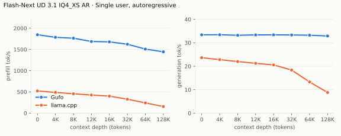

---

<!-- bench:single-ar-iq3 -->
| Flash-Next UD 3.1 IQ3_XXS AR Depth (tokens) | Gufo pp (tok/s) | llama.cpp pp (tok/s) | Gain | Gufo tg (tok/s) | llama.cpp tg (tok/s) | Gain |
| ---: | ---: | ---: | ---: | ---: | ---: | ---: |
| 0 | 1821.02 | 500.44 | +263.9% | 34.38 | 23.76 | +44.7% |
| 4,096 | 1753.12 | 467.71 | +274.8% | 34.46 | 23.04 | +49.6% |
| 8,192 | 1733.28 | 440.84 | +293.2% | 34.16 | 22.26 | +53.5% |
| 12,288 | 1637.51 | 411.58 | +297.9% | 34.36 | 21.41 | +60.5% |
| 16,384 | 1649.93 | 388.68 | +324.5% | 34.36 | 20.73 | +65.8% |
| 32,768 | 1601.33 | 319.26 | +401.6% | 34.34 | 18.57 | +84.9% |
| 65,536 | 1508.05 | 237.82 | +534.1% | 34.11 | 13.67 | +149.5% |
| 131,072 | 1446.02 | 158.01 | +815.1% | 33.73 | 9.47 | +256.2% |
<!-- /bench -->

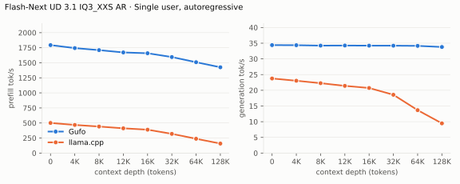

## Single user, MTP

pp is the highest measured rate per engine and depth across mixed/repetitive
text, including Gufo predictor catch-up.

<!-- bench:single-mtp-iq4 -->
| Flash-Next UD 3.1 IQ4_XS MTP Depth (tokens) | Gufo pp (tok/s) | llama.cpp pp (tok/s) | Gain pp | Gufo tg mixed (tok/s) | llama.cpp tg mixed (tok/s) | Gain mixed | Gufo tg repetitive (tok/s) | llama.cpp tg repetitive (tok/s) | Gain repetitive |
| ---: | ---: | ---: | ---: | ---: | ---: | ---: | ---: | ---: | ---: |
| 0 | 1797.68 | 488.40 | +268.1% | 42.21 | 32.30 | +30.7% | 106.20 | 45.47 | +133.6% |
| 4,096 | 1682.21 | 452.39 | +271.8% | 49.11 | 35.36 | +38.9% | 103.97 | 44.41 | +134.1% |
| 8,192 | 1655.28 | 426.78 | +287.9% | 51.10 | 30.24 | +69.0% | 108.42 | 43.59 | +148.7% |
| 12,288 | 1598.78 | 401.15 | +298.5% | 51.16 | 28.91 | +77.0% | 105.85 | 41.66 | +154.1% |
| 16,384 | 1574.00 | 377.02 | +317.5% | 49.03 | 30.75 | +59.4% | 104.17 | 41.46 | +151.3% |
| 32,768 | 1535.25 | 309.07 | +396.7% | 48.25 | 27.34 | +76.5% | 105.14 | 39.10 | +168.9% |
| 65,536 | 1462.35 | 223.56 | +554.1% | 47.58 | 19.87 | +139.5% | 105.50 | 29.23 | +260.9% |
| 131,072 | 1413.40 | N/A | N/A | 48.41 | N/A | N/A | 107.40 | N/A | N/A |
<!-- /bench -->

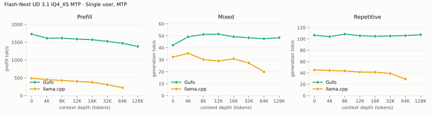

---

<!-- bench:single-mtp-iq3 -->
| Flash-Next UD 3.1 IQ3_XXS MTP Depth (tokens) | Gufo pp (tok/s) | llama.cpp pp (tok/s) | Gain pp | Gufo tg mixed (tok/s) | llama.cpp tg mixed (tok/s) | Gain mixed | Gufo tg repetitive (tok/s) | llama.cpp tg repetitive (tok/s) | Gain repetitive |
| ---: | ---: | ---: | ---: | ---: | ---: | ---: | ---: | ---: | ---: |
| 0 | 1740.43 | 477.54 | +264.5% | 49.45 | 32.18 | +53.7% | 101.97 | 46.79 | +117.9% |
| 4,096 | 1615.01 | 437.10 | +269.5% | 47.57 | 33.04 | +44.0% | 105.83 | 43.89 | +141.1% |
| 8,192 | 1594.99 | 411.91 | +287.2% | 45.90 | 30.57 | +50.1% | 106.42 | 44.35 | +140.0% |
| 12,288 | 1576.80 | 388.08 | +306.3% | 46.31 | 29.19 | +58.7% | 101.11 | 42.88 | +135.8% |
| 16,384 | 1563.48 | 364.21 | +329.3% | 49.90 | 27.17 | +83.7% | 99.95 | 41.78 | +139.2% |
| 32,768 | 1541.85 | 300.76 | +412.7% | 48.63 | 28.76 | +69.1% | 98.26 | 38.52 | +155.1% |
| 65,536 | 1458.07 | 222.00 | +556.8% | 45.68 | 19.43 | +135.1% | 100.50 | 30.12 | +233.7% |
| 131,072 | 1391.87 | 146.93 | +847.3% | 46.91 | 14.94 | +214.0% | 99.23 | 21.65 | +358.3% |
<!-- /bench -->

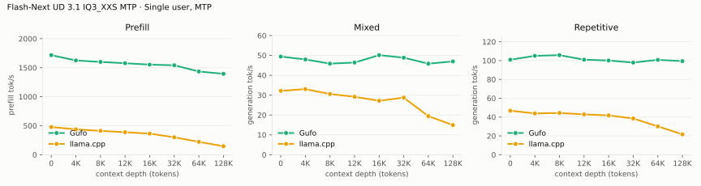

## Multiple users, autoregressive

Same pp2048 prose prompt as single-user d0, tg128, context 4096 per user.
All sessions prefilled before timed decoding; throughput sums individual rates.

<!-- bench:multi-ar-iq4 -->
| Flash-Next UD 3.1 IQ4_XS AR Users | Gufo AR (tok/s) | llama.cpp AR (tok/s) | Gain |
| ---: | ---: | ---: | ---: |
| 1 | 33.43 | 24.35 | +37.3% |
| 2 | 56.09 | 39.53 | +41.9% |
| 4 | 84.37 | 58.43 | +44.4% |
| 6 | 99.77 | 65.82 | +51.6% |
| 8 | 105.83 | 69.24 | +52.8% |
<!-- /bench -->

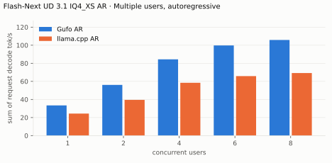

---

<!-- bench:multi-ar-iq3 -->
| Flash-Next UD 3.1 IQ3_XXS AR Users | Gufo AR (tok/s) | llama.cpp AR (tok/s) | Gain |
| ---: | ---: | ---: | ---: |
| 1 | 34.36 | 24.97 | +37.6% |
| 2 | 57.34 | 39.49 | +45.2% |
| 4 | 85.29 | 57.54 | +48.2% |
| 6 | 98.08 | 64.37 | +52.4% |
| 8 | 103.13 | 67.25 | +53.4% |
<!-- /bench -->

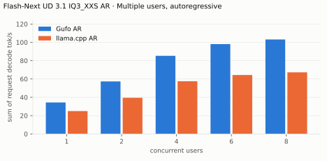

## Multiple users, MTP

Same pp2048 mixed/repetitive prompts as single-user d0, tg128, context 4096
per user. All sessions prefilled before timed decoding; rates sum individual
request decode rates.

<!-- bench:multi-mtp-iq4 -->
| Flash-Next UD 3.1 IQ4_XS MTP Users | Gufo mixed (tok/s) | llama.cpp mixed (tok/s) | Gain | Gufo repetitive (tok/s) | llama.cpp repetitive (tok/s) | Gain |
| ---: | ---: | ---: | ---: | ---: | ---: | ---: |
| 1 | 42.00 | 32.43 | +29.5% | 107.07 | 46.62 | +129.7% |
| 2 | 71.64 | 45.20 | +58.5% | 117.89 | 53.02 | +122.4% |
| 4 | 85.68 | 50.22 | +70.6% | 120.81 | 49.73 | +142.9% |
| 6 | 88.01 | 57.51 | +53.0% | 123.76 | 52.08 | +137.6% |
| 8 | 91.86 | 63.03 | +45.7% | 125.69 | 57.54 | +118.4% |
<!-- /bench -->

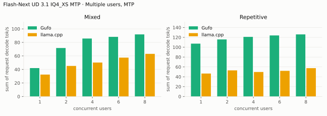

---

<!-- bench:multi-mtp-iq3 -->
| Flash-Next UD 3.1 IQ3_XXS MTP Users | Gufo mixed (tok/s) | llama.cpp mixed (tok/s) | Gain | Gufo repetitive (tok/s) | llama.cpp repetitive (tok/s) | Gain |
| ---: | ---: | ---: | ---: | ---: | ---: | ---: |
| 1 | 49.01 | 33.12 | +48.0% | 102.27 | 47.93 | +113.4% |
| 2 | 73.18 | 50.15 | +45.9% | 108.85 | 53.21 | +104.6% |
| 4 | 84.58 | 50.72 | +66.8% | 111.46 | 51.31 | +117.2% |
| 6 | 87.42 | 56.67 | +54.3% | 113.68 | 53.29 | +113.3% |
| 8 | 90.16 | 64.33 | +40.2% | 114.47 | 69.27 | +65.3% |
<!-- /bench -->

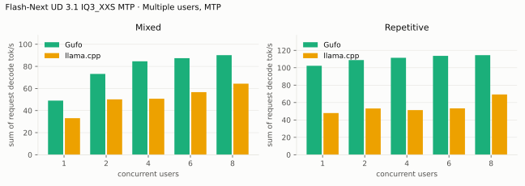

## Loading time

C1, context capacity 262144. Cold target/sidecar files to HTTP readiness;
Gufo loads MTP, llama.cpp AR only (its UD-IQ4_XS MTP server already ran out
of memory at capacity 133,760).

<!-- bench:loading -->
| Flash-Next UD 3.1 Target | Gufo ready (s) | llama.cpp ready (s) | Gain |
| --- | ---: | ---: | ---: |
| IQ3_XXS | 10.07 | 24.84 | +146.7% |
| IQ4_XS | 11.63 | 34.51 | +196.7% |
<!-- /bench -->

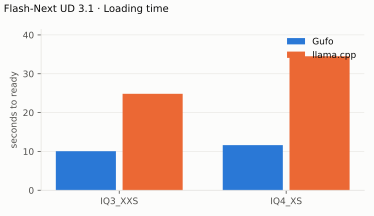

## Memory occupation

C1, context capacity 133121, AR. Peak memory reported by HIP. llama.cpp's
figure excludes the 27.5 GiB per-layer embedding it holds in host memory;
Gufo reads that tensor through the reclaimable file cache.

<!-- bench:memory-iq4 -->
| Flash-Next UD 3.1 IQ4_XS AR Workload | Gufo GiB | llama.cpp GiB | Gain |
| --- | ---: | ---: | ---: |
| pp2048 + tg128 | 75.48 | 71.88 | -4.8% |
| 16K prefix, pp4096 + tg128 | 77.22 | 72.21 | -6.5% |
<!-- /bench -->

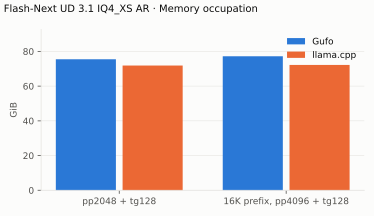

---

<!-- bench:memory-iq3 -->
| Flash-Next UD 3.1 IQ3_XXS AR Workload | Gufo GiB | llama.cpp GiB | Gain |
| --- | ---: | ---: | ---: |
| pp2048 + tg128 | 66.22 | 62.52 | -5.6% |
| 16K prefix, pp4096 + tg128 | 67.96 | 62.85 | -7.5% |
<!-- /bench -->

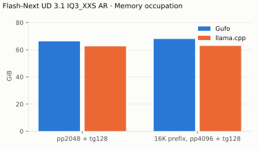

## Older files

Unsloth's three-shard UD-IQ4_XS and UD-IQ3_XXS from revision `38bb39ee`,
which UD 3.1 replaced. Gufo only, the same binary, host and settings as the
tables above, November 11, 2026; artifacts in
[`artifacts/older-files/`](artifacts/older-files/), whose `iq3`/`iq4`
variants are these files. Depth is the cached prefix in tokens; 8-user rows
are total decode.

| Flash-Next older files, Gufo | UD-IQ4_XS (tok/s) | UD-IQ3_XXS (tok/s) |
| --- | ---: | ---: |
| AR pp, depth 0 | 1808.19 | 1836.10 |
| AR pp, depth 131,072 | 1471.89 | 1493.43 |
| AR tg, depth 0 | 31.94 | 34.16 |
| AR tg, depth 131,072 | 31.46 | 33.55 |
| MTP tg mixed, depth 0 | 42.48 | 48.90 |
| MTP tg mixed, depth 131,072 | 47.98 | 43.88 |
| MTP tg repetitive, depth 0 | 152.41 | 106.81 |
| MTP tg repetitive, depth 131,072 | 134.57 | 92.53 |
| 8 users AR | 136.96 | 104.08 |
| 8 users MTP mixed | 126.82 | 89.00 |

The older UD-IQ4_XS keeps a Q8_0 trunk and IQ3_S/IQ4_NL experts; it is the
fastest of the four files when many rows are decoded or verified at once.
Single-user AR and MTP completions match at depth 0, and every 8-user
completion matches its AR C1 reference.
